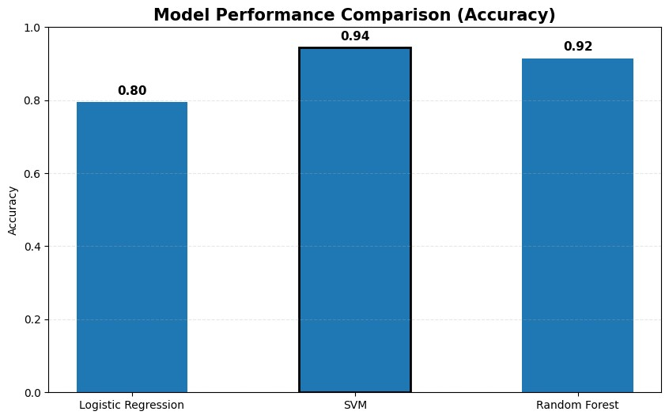
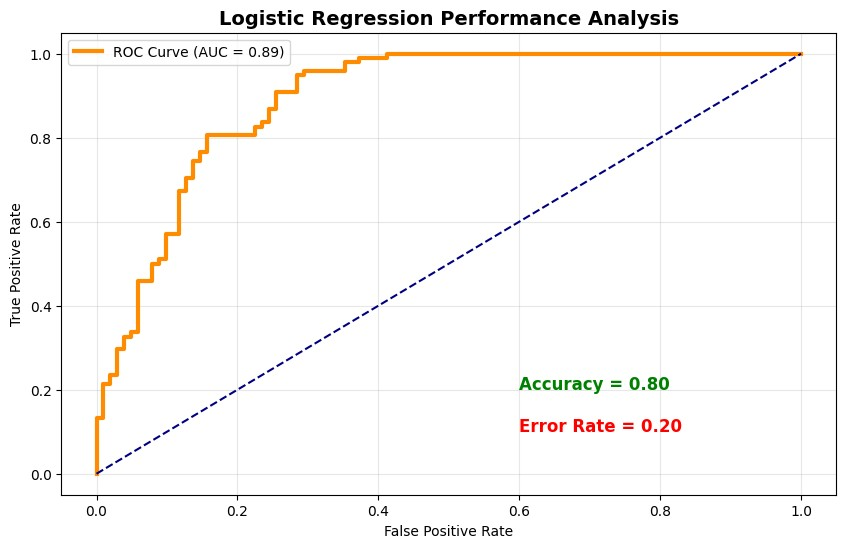
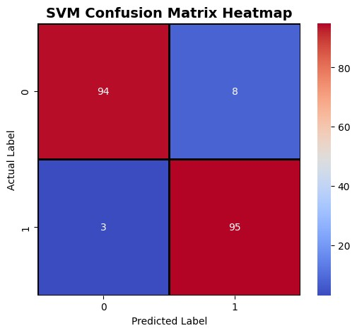
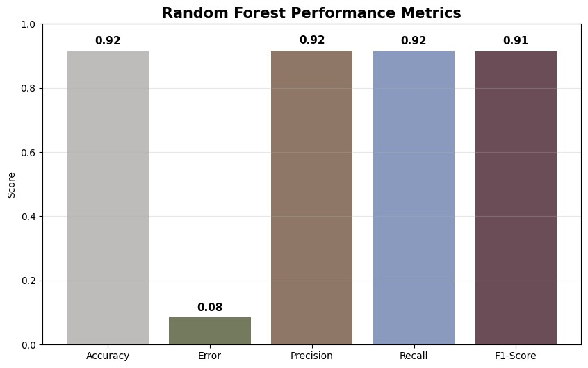
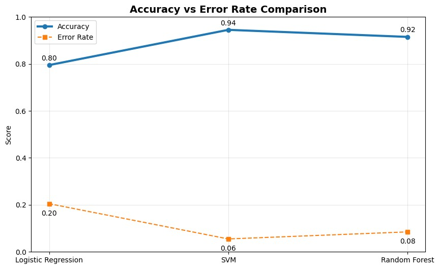

# Machine Learning Based Vehicle Classification for Indian Roads

A machine learning project that compares three classification algorithms (Logistic Regression, Support Vector Machine and Random Forest) to find the most accurate model for classifying vehicles. Vehicle classification is used in traffic control, surveillance, toll collection and parking management.

Course project for Machine Learning, B.Tech CSE, SR University.

## Models compared

| Model | What it brings |
| --- | --- |
| Logistic Regression | Simple and fast baseline for classification |
| Support Vector Machine (RBF kernel) | Handles complex, high-dimensional data |
| Random Forest (100 trees) | Combines many decision trees and reduces overfitting |

## Dataset and setup

- Data is generated with scikit-learn's `make_classification`: 1000 samples, 20 features (10 informative, 5 redundant), 2 classes.
- The data is synthetic, so the results compare the algorithms rather than measure performance on real traffic data.
- 80/20 train-test split (800 training and 200 test samples), `random_state=42`.
- Metrics: accuracy, error rate, precision, recall, F1-score, confusion matrix and ROC curve.

## Results

| Model | Accuracy | Error rate | Precision | Recall | F1-score |
| --- | --- | --- | --- | --- | --- |
| Logistic Regression | 79.5% | 20.5% | 0.80 | 0.80 | 0.79 |
| **SVM** | **94.5%** | **5.5%** | **0.95** | **0.94** | **0.94** |
| Random Forest | 91.5% | 8.5% | 0.92 | 0.92 | 0.91 |

Precision, recall and F1 are weighted averages on the 200 test samples. **SVM gave the best accuracy**, followed by Random Forest, with Logistic Regression lowest.



| ROC curve (Logistic Regression) | Confusion matrix (SVM) |
| --- | --- |
|  |  |

| Random Forest metrics | Accuracy vs error rate |
| --- | --- |
|  |  |

## How to run

```bash
git clone https://github.com/<your-username>/vehicle-classification-ml.git
cd vehicle-classification-ml
pip install -r requirements.txt
python vehicle_classification.py
```

The script trains all three models, prints their metrics and shows the plots.

## Project structure

```
vehicle-classification-ml/
├── vehicle_classification.py   # training, evaluation and plots
├── requirements.txt
├── images/                     # output charts
└── report/                     # full project report (.docx)
```

## Author

Thokala Srivalli, B.Tech CSE, SR University
